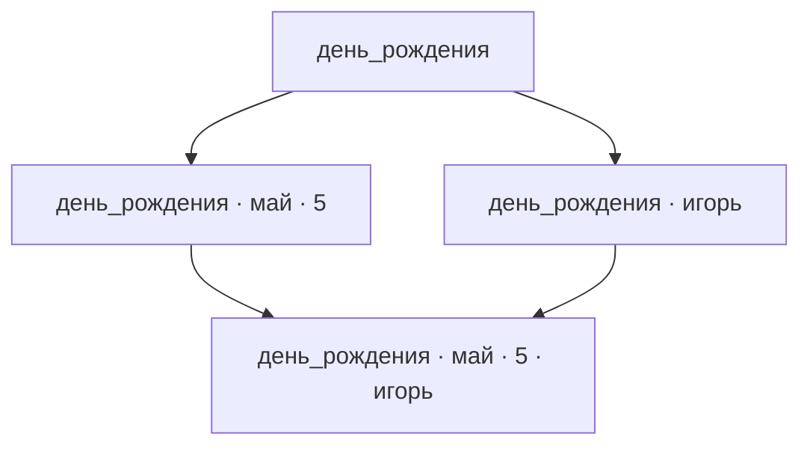

# Теготека: идея продукта

## 1. Назначение продукта

Теготека помогает быстро находить нужные записи — тексты, изображения, аудиозаписи, видеозаписи и другие материалы. Такие записи называются **элементами**.

Для отбора элементов используются **теги** — обозначения, назначаемые элементам. Пользователь выбирает нужные теги при поиске.

Главный принцип представления — в каждый момент времени показывать пользователю по возможности наиболее обозримый результат из элементов, максимально релевантных выбранным пользователем тегам.

### Принципы интерфейса

Интерфейс должен быть интуитивно понятным и не требовать пояснений для работы с ним. Понятность обеспечивается обозначениями и поведением интерфейса, без поясняющих текстов, занимающих экранное место и создающих визуальный шум.

При разработке используется подход **Mobile First**: интерфейс проектируется прежде всего для смартфонов с одновременной поддержкой десктопов.

Приоритеты функциональности по скорости и удобству доступа, в порядке убывания:

1. Навигация, фильтрация и поиск.
2. Создание новых элементов.
3. Редактирование элементов.
4. Изменение режимов отображения.
5. Настройки.

Чем выше приоритет функциональности, тем быстрее и удобнее должен быть доступ к ней и тем меньше пользовательских действий должно требоваться для её выполнения. Прокрутка, клики, тапы и другие действия минимизируются прежде всего для более приоритетной функциональности. Эти приоритеты действуют во всех форматах интерфейса, включая смартфоны и десктопы.

## 2. Элементы, теги и рабочая область

**Рабочая область** — совокупность элементов, доступных тегов и необязательных поясняющих описаний этих тегов.

**Текущий набор тегов рабочей области** — теги, доступные в ней для разметки элементов и навигации.

**Глоссарий тегов рабочей области** — текущий набор тегов рабочей области вместе с необязательными поясняющими описаниями этих тегов.

**Содержание элемента** — текст, изображение, аудиозапись, видеозапись или другое содержимое, отдельное от тегов элемента.

**Теговая разметка элемента** — полный набор тегов, назначенных элементу в данной рабочей области. **Разметка** — назначение элементу тегов из текущего набора тегов рабочей области.

**Базовая функциональность** — обязательный набор возможностей продукта.

Пользователь может начать с пустого или небольшого набора тегов. Когда при разметке встречается тег, которого ещё нет в текущем наборе рабочей области, он автоматически добавляется в этот набор. Для каждого нового тега пользователю предлагается задать поясняющее описание его смысла. Тег становится доступным для использования независимо от наличия описания. Теги, не назначенные ни одному элементу, не удаляются из набора автоматически.

Так при разметке элементов постепенно формируется глоссарий тегов рабочей области.

Пользователь может переименовать тег. Новое название заменяет старое во всей рабочей области. Назначения тега элементам сохраняются. Если новое название уже используется другим тегом рабочей области, переименование не выполняется и пользователю предлагается выбрать другое название.

Пользователь может удалить любой тег из текущего набора тегов рабочей области. Перед удалением показывается число элементов рабочей области, которым назначен этот тег, и запрашивается подтверждение пользователя. После подтверждения тег удаляется из набора и из разметки этих элементов. Сами элементы и остальные назначенные им теги сохраняются.

В базовой функциональности теги назначаются пользователем вручную.

**Название элемента** — необязательное свойство, помогающее пользователю узнать элемент при просмотре. Название отделено от содержания и теговой разметки. Разные элементы могут иметь одинаковые названия, в том числе при одинаковой теговой разметке.

При изменении названия или теговой разметки элемент считается тем же, если содержание не меняется. При изменении содержания результат считается другим элементом и заменяет исходную запись в рабочей области.

В базовой функциональности элемент может содержать материал одного вида или иметь пустое содержание. Например, запись с тегами `игорь артемьев май день_рождения 5` может иметь пустое содержание. Теги позволяют понять, о каком факте идёт речь, и остаются тегами, отдельными от содержания записи.

Текстовые элементы должны быть обозримыми: обычно не более одного абзаца, максимум несколько абзацев. Примеры таких элементов — анекдоты, афоризмы, тосты, стихи и заметки разного характера.

Типовые аудио- и видеоэлементы — песни, ролики и рассказанные анекдоты. Их продолжительность, как правило, не превышает пяти минут.

Каждая операция разметки отдельного элемента **атомарна**: она выполняется как единое неделимое действие. Разметку одного и того же элемента можно выполнять повторно, в том числе для приведения разметки в соответствие содержимому.

**Размеченный элемент** — элемент, для которого задана теговая разметка в данной рабочей области.

**Неразмеченный элемент** — элемент, для которого такая разметка не задана.

Заданная разметка может быть пустым набором тегов. Пользователь может в любой момент изменить разметку, сохраняя соответствие тегов содержанию элемента.

## 3. Узлы и выборки

**Теговая выборка** — совокупность всех размеченных элементов рабочей области, которым назначены все теги выбранного набора.

Для организации элементов и навигации продукт использует граф наборов тегов рабочей области. Рёбра отражают включение одних наборов тегов в другие.

**Узел** — вершина графа продукта, соответствующая уникальному набору тегов из числа доступных в рабочей области.

**Выборка узла** — теговая выборка, заданная набором тегов этого узла.

Узлы различаются по задающим их тегам. Два разных узла могут иметь одинаковые по составу выборки.

Пользователь может выбрать для отбора элементов любые теги из текущего набора тегов рабочей области. Эти теги называются **выбранными тегами**, узел с этим набором — **текущим узлом**, а его выборка — **текущей выборкой**.

**Собственный элемент узла** — размеченный элемент, теговая разметка которого полностью совпадает с набором тегов узла. Выражение «элемент принадлежит узлу» обозначает это точное совпадение.

**Заполненный узел** — узел, имеющий хотя бы один собственный элемент.

**Незаполненный узел** — узел, не имеющий собственных элементов. Команда удаления незаполненного узла не предусмотрена.

**Непустая выборка** — выборка, содержащая хотя бы один элемент.

**Корень (корневой узел)** — узел с пустым набором тегов. Его выборка включает все размеченные элементы рабочей области.

При изменении выбранных тегов:

- Добавление тегов сужает выборку.
- Удаление тегов расширяет выборку.

Например, пусть существует только одна запись с разметкой `день_рождения май 5`:

| Узел | Собственные элементы | Выборка |
| --- | --- | --- |
| `день_рождения` | Нет | Содержит запись |
| `день_рождения май` | Нет | Содержит запись |
| `день_рождения май 5` | Эта запись | Содержит запись |

В этом примере заполнен только последний узел, а выборки всех трёх узлов непусты.

## 4. Иерархия и связи между узлами

Узлы образуют иерархию по включению наборов тегов.

**Потомок узла** — узел, имеющий все теги исходного узла и хотя бы один дополнительный тег.

**Предок узла** — узел, набор тегов которого строго включён в набор тегов исходного узла.

**Промежуточный узел** между предком и потомком — узел, имеющий все теги предка и непустую часть дополнительных тегов потомка, но не все эти дополнительные теги.

Если набор тегов одного узла строго входит в набор другого, выборка первого включает выборку второго.

Выборка узла включает его собственные элементы и собственные элементы всех его потомков.

Таким образом, у узла может не быть собственных элементов, хотя его выборка непуста за счёт потомков.

Иерархия узлов образует направленный ациклический граф (DAG).

### DAG всех наборов тегов

Если текущий набор тегов рабочей области содержит n тегов, полный DAG содержит 2ⁿ узлов, включая корень с пустым набором тегов. Ребро соответствует добавлению одного тега.

Цикл невозможен: движение по направлению рёбер каждый раз увеличивает набор тегов. В один узел могут входить несколько рёбер, и из него могут выходить несколько рёбер.

### Виды близости

Различаются три понятия близости:

| Понятие | Определение |
| --- | --- |
| Соседние узлы | Два узла, один из которых получается из другого добавлением или удалением одного тега. Заполненность не обязательна. |
| Ближайшие заполненные узлы | Заполненные предки и потомки текущего узла, чьи наборы тегов получаются из текущего набора наименьшим числом добавлений либо удалений тегов. |
| Соседние заполненные узлы | Заполненные предки и потомки текущего узла, между которыми и текущим нет других заполненных узлов. |

### Граф соседства заполненных узлов

**Граф соседства заполненных узлов** — граф, вершинами которого служат заполненные узлы, а рёбра связывают соседние заполненные узлы. Рёбра направлены от меньшего набора тегов к большему. Такое представление порядка называется диаграммой Хассе.

Граф соседства заполненных узлов служит для навигации между ними, позволяя пропускать промежуточные незаполненные узлы.

Одно ребро графа соседства заполненных узлов может соответствовать добавлению нескольких тегов. Поэтому число рёбер и число изменяемых тегов — разные величины. При построении графа соседства на основе DAG всех наборов тегов связи между заполненными узлами определяются заново.

Например, пусть заполнены только четыре следующих узла:

Узлы `день_рождения май 5` и `день_рождения` — соседние заполненные узлы, хотя ребро между ними соответствует добавлению двух тегов. В узел с четырьмя тегами входят два ребра.

## 5. Навигация

**Переход к узлу** — действие, в результате которого выбранный узел становится текущим. Выбранные теги, выборка и предлагаемые переходы обновляются в соответствии с этим узлом.

Пользователь может перейти из любого узла в любой другой, задав его набор тегов. Заполненность исходного узла и узла назначения не ограничивает возможность перехода.

Для любого текущего узла, в том числе незаполненного, пользователю предлагаются переходы к соседним заполненным предкам и потомкам этого узла, если они есть.

Пользователь может двигаться по рёбрам в обе стороны: по их направлению — добавляя теги и сужая выборку, против их направления — удаляя теги и расширяя её.

Навигационный приоритет заполненных узлов соответствует их близости к текущему узлу: **чем меньше тегов нужно добавить или удалить для перехода, тем выше приоритет**.

Для перехода к соседнему заполненному узлу может потребоваться добавить в набор выбранных тегов или удалить из него сразу несколько тегов. Например, пусть для перехода к соседнему заполненному потомку нужно добавить два тега, а для перехода к соседнему заполненному предку — удалить четыре. В этом случае потомок имеет более высокий навигационный приоритет, поскольку переход к нему требует изменения меньшего числа тегов.

При первом открытии рабочей области текущим становится корень. При повторном открытии восстанавливается последний посещённый узел.

Из любого узла пользователь может перейти в корень одним действием — например, нажатием отдельной кнопки. При таком переходе снимаются все выбранные теги.

При удалении из рабочей области одного из выбранных тегов текущим становится узел с оставшимися выбранными тегами. Если выбранных тегов не осталось, текущим становится корень.

### Симметрия направлений

**Родительский и дочерний узлы** — узлы, соединённые одним направленным ребром: от родительского к дочернему.

У узла могут быть несколько родителей и несколько дочерних узлов.

В навигации по заполненным узлам направления «вверх» ведут к соседним заполненным предкам, направления «вниз» — к соседним заполненным потомкам. В обоих направлениях переход может изменять несколько тегов.

Симметрия направлений используется там, где она помогает пользователю ориентироваться и получать обозримый, релевантный результат. Способы представления предков и потомков выбираются по их полезности для пользователя.

### Обозначения узла и переходов

Текущий узел обозначается полным набором тегов. Переходы к соседним заполненным узлам обозначаются изменением этого набора: знаком `+` и добавляемыми тегами либо знаком `−` и удаляемыми тегами. В обозначении перечисляются все изменяемые при переходе теги.

Например, из узла `ремонт кухня`:

| Узел назначения | Обозначение перехода |
| --- | --- |
| `ремонт кухня электрика` | `+ электрика` |
| `ремонт` | `− кухня` |
| `кухня` | `− ремонт` |

### Предлагаемые переходы

**Набор предлагаемых переходов** — варианты сужения и расширения выборки.

По умолчанию показывается компактный набор наиболее приоритетных переходов. Остальные доступны по запросу. Этот принцип применяется к переходам как к предкам, так и к потомкам. Постраничный просмотр предлагаемых переходов может использоваться только для переходов к потомкам.

### Сведения об узлах

При представлении соседних заполненных узлов общее количество элементов выборки отражается всегда. Количество собственных элементов узла отражается в зависимости от настроек пользователя.

Числовое обозначение этих показателей необязательно: количество может передаваться стилистически — например, интенсивностью цвета, размером шрифта или их сочетанием. Стилистическое обозначение также может сочетаться с числовым.

### История переходов

История переходов отражает навигационные действия пользователя. По ней можно перемещаться назад и вперёд, как в веб-браузере.

- **Назад** — переход к предыдущему доступному узлу в истории.
- **Вперёд** — переход к следующему доступному узлу в истории после возврата назад.

Изменения рабочей области сами по себе не добавляют посещений и не отбрасывают продолжение истории. Порядок посещений сохраняется. Навигация учитывает актуальное состояние рабочей области.

Если после возврата назад пользователь выбирает новый узел для перехода, прежнее продолжение истории заменяется этим переходом. Движение назад и вперёд по самой истории новых записей в неё не добавляет.

## 6. Просмотр узла

### Состав элементов для просмотра

По умолчанию выбран просмотр собственных элементов текущего узла. Для просмотра собственных элементов другого узла пользователь переходит в него.

Пользователь может переключаться между просмотром собственных элементов и просмотром выборки узла, не меняя выбранных тегов. При просмотре выборки узла собственные элементы текущего узла должны визуально выделяться среди элементов потомков.

В обоих вариантах доступны предлагаемые переходы к соседним заполненным предкам и потомкам. Показ самих элементов определяется правилами обозримости и выбранным способом показа, описанными ниже.

### Обозримость и способы показа

По умолчанию элементы показываются только тогда, когда их множество обозримо. Критерии обозримости определяются в настройках и применяются к выбранному составу: собственным элементам текущего узла или всей его выборке.

Поддерживаются три способа показа:

| Способ | Правило |
| --- | --- |
| По заданному пределу количества — по умолчанию | Элементы не показываются, пока их число превышает максимум, заданный в настройках. При числе элементов, не превышающем максимум, показываются все. |
| По вместимости экрана | Элементы показываются только тогда, когда все они целиком одновременно помещаются в доступной для них области экрана без прокрутки. Это частный случай ограничения количества: максимум вычисляется динамически для текущего экрана и представления элементов. |
| Постраничный просмотр | Элементы показываются по страницам с размером, заданным в настройках. Этот способ позволяет просматривать множество независимо от его общей численности. |

Исключение из ограничения обозримости — просмотр крайних позиций отсортированного множества по запросу пользователя. Пользователь может посмотреть первые или последние элементы, например наиболее недавно отредактированные, даже если всё множество не удовлетворяет выбранному критерию обозримости.

Ограничения показа не меняют состав выборки и доступность навигации. Состояние, в котором элементы скрыты из-за ограничения обозримости, должно отличаться от отсутствия элементов.

### Состояние текущего узла

После удаления последнего собственного элемента или изменения его разметки пользователь остаётся в текущем узле с прежними выбранными тегами, если эти теги остаются доступны в рабочей области.

В режиме просмотра собственных элементов для незаполненного текущего узла различаются два состояния:

| Состояние | Представление |
| --- | --- |
| Собственных элементов нет, но есть заполненные потомки | Обозначение отсутствия собственных элементов. |
| Нет ни собственных элементов, ни заполненных потомков | Сообщение об отсутствии элементов с выбранными тегами. |

В обоих состояниях пользователь видит теги текущего узла и может изменять их, переходя в другие узлы независимо от их заполненности. Также доступны история переходов, выход в корень и добавление элемента.

### Сортировка и сохранение выбора

Пользователь может быстро переключаться между сортировкой элементов по времени последнего изменения и по названию. По умолчанию элементы упорядочены от наиболее недавно изменившихся к более ранним.

При сортировке по названию элементы без названия располагаются в конце. Элементы с одинаковыми названиями упорядочиваются по времени последнего изменения: недавно изменившиеся — первыми.

Для нового элемента время последнего изменения — это время его добавления в рабочую область. Изменение названия или теговой разметки обновляет это время.

Выбор между просмотром собственных элементов и выборки узла, способ показа и сортировка сохраняются при изменении данных и переходах между узлами, включая переходы назад и вперёд по истории и выход в корень.

При изменении заполненности узлов предлагаемые переходы сразу обновляются в соответствии с новым соседством. Текущий узел сохраняется, если все его теги остаются доступны в рабочей области.

Например, пользователь вводит имя знакомого и формирует выборку записей, которым назначен этот тег. Если выборка не удовлетворяет критерию обозримости, он сужает её дополнительными тегами, например фамилией. Когда элементы показаны, он ищет среди них запись о дне рождения. Обратный сценарий — задать дату и найти записи о людях, у которых на неё приходится день рождения.

## 7. Помощь при вводе тегов

**Автодополнение** — предложение подходящих тегов по мере их набора. Оно работает начиная с первого тега и помогает выбирать каждый следующий тег.

При добавлении тега для навигации автодополнение предлагает соответствующие вводимому тексту теги, которые встречаются в элементах выборки текущего узла и ещё не выбраны.

## 8. Работа с элементами

### Режим разметки

Неразмеченные элементы доступны в отдельном списке независимо от текущей выборки. Работа с ними выполняется в отдельном режиме разметки.

Пользователь может размечать элементы из этого списка в удобное время и возвращаться к оставшимся позже. Разметка каждого элемента сохраняется отдельно.

По мере разметки элементы начинают участвовать в выборках, не дожидаясь разметки остальных элементов.

Прогресс процесса разметки должен обозначаться визуально.

Во время изменения разметки элемента пользователь всегда видит исходный набор тегов — тот, который был у элемента до начала редактирования. Он показывается для сравнения с редактируемым набором. После сохранения изменений исходный набор не сохраняется для последующего просмотра.

### Создание, редактирование и удаление

В типовом сценарии пользователь постепенно наполняет рабочую область, добавляя запись за записью.

Основной сценарий создания нового элемента — сохранение с разметкой. Теги текущего узла автоматически предлагаются в качестве начальной разметки. Пользователь может оставить их, дополнить или изменить.

Как дополнительная возможность поддерживается быстрое сохранение нового элемента без разметки. В этом случае элемент попадает в список неразмеченных для последующей разметки.

Редактирование элемента доступно из любого представления, в котором пользователь может просматривать этот элемент, независимо от текущего узла и принадлежности элемента узлу.

При ручном изменении содержания или теговой разметки элемента пользователь проверяет их соответствие и при необходимости корректирует содержание или теги.

При редактировании содержания пользователь видит текущие теги. При изменении тегов ему доступно содержание элемента для чтения, просмотра или воспроизведения.

**Перемещение элемента** — замена его разметки полным набором тегов указанного узла той же рабочей области. Если соответствие этого набора содержанию обеспечить невозможно, перемещение не выполняется.

Перед сохранением изменённого содержания пользователь получает напоминание о том, что теги должны соответствовать новому содержанию. Напоминание включено по умолчанию и может быть отключено в настройках.

После сохранения созданного или отредактированного элемента пользователь остаётся в текущем узле. Если элемент размечен и принадлежит другому узлу, пользователь видит этот узел и предложение перейти в него. Переход выполняется по выбору пользователя.

Пользователь может удалить элемент из рабочей области. Восстановление удалённых элементов не предусмотрено.

## 9. Базовая функциональность

| Направление | Возможности |
| --- | --- |
| Рабочие области | Работа с элементами разных типов и текущим набором тегов рабочей области. Новые теги при разметке добавляются в этот набор; для каждого предлагается задать поясняющее описание. Так формируется глоссарий тегов рабочей области. Переименование тегов с сохранением их назначений элементам. Удаление тегов после показа числа элементов с удаляемым тегом и подтверждения пользователя. |
| Наполнение и разметка | Постепенное добавление элементов. Сохранение с разметкой — основной сценарий; быстрое сохранение без разметки — дополнительная возможность. Ручное назначение и изменение тегов, включая перемещение элементов к указанным узлам. Отдельный список неразмеченных элементов с возможностью вернуться к их разметке позже. Разметка каждого элемента сохраняется отдельно. Прогресс разметки обозначается визуально. |
| Редактирование и удаление | Редактирование содержания с поддержкой его соответствия тегам. Удаление элементов из рабочей области. Восстановление удалённых элементов не предусмотрено. |
| Теговые выборки | Быстрый отбор элементов по всем выбранным тегам и автодополнение при вводе тегов. |
| Навигация | Сужение и расширение выборки добавлением и удалением тегов. Набор предлагаемых переходов к соседним заполненным узлам с приоритетом по близости, история назад и вперёд, выход в корень одним действием. |
| Просмотр | Выбор между собственными элементами узла — по умолчанию — и его выборкой с выделением собственных элементов. Показ по заданному пределу количества, по вместимости экрана или постранично; по запросу — крайние позиции отсортированного множества. Параметры обозримости и размер страницы задаются в настройках. Сортировка по времени последнего изменения или по названию, по умолчанию — недавно изменившиеся первыми. Выбор варианта просмотра, способ показа и сортировка сохраняются при изменении данных и переходах. |

## 10. Расширения

У продукта могут быть расширения. Правила взаимодействия с ними описаны в документе [«Соглашения продукта с расширениями»](PRODUCT_EXTENSION_AGREEMENTS.md).

## 11. Вопросы дальнейшего развития

- Какие правила могут определять подбор направлений навигации через замену тегов, в том числе к узлам с тем же числом тегов?
- Стоит ли предоставлять пользователю возможность ручной группировки через промежуточные узлы без собственных элементов, и как она должна работать?

## 12. Пояснение: аналогия с файловой системой

Режим просмотра собственных элементов можно пояснить аналогией с файловой системой: текущий узел похож на открытую папку, его собственные элементы — на файлы в ней, а переходы к соседним заполненным потомкам — на открытие вложенных папок.

У аналогии есть границы. В древовидной иерархии у корня нет родителя, а у каждого другого узла ровно один родитель. В DAG у узла может быть несколько родителей: из разных родительских узлов можно открыть один и тот же узел с одними и теми же собственными элементами. Правила просмотра и изменения элементов определяются теговой моделью.

[Справочник терминов проекта](GLOSSARY.md) содержит определения общих понятий базовой модели.

[Правила организации документации](DOCUMENTATION_RULES.md).
